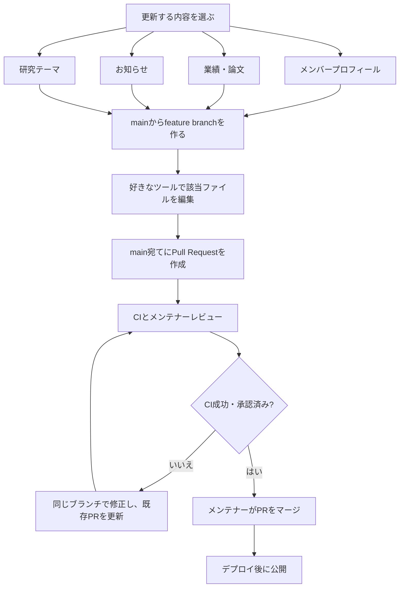

# コンテンツの投稿ガイド

メンバーは、自分のプロフィールや業績などを追加・更新し、変更の確認を依頼するPull Request（PR）で提出できます。編集方法は自由です。GitHub Web画面、VS Code、Git CLI、Codexなど、使いやすいツールを選んでください。

## 1. はじめに

- 投稿する人が、氏名・役割・研究内容・論文情報などの正確さを確認してください。情報を推測して書かないでください。
- このガイドは `src/content/` のコンテンツを更新する手順です。ページの見た目やプログラムを変更したい場合は、先にメンテナーへ相談してください。
- 既存の `sample-*.yaml` と `sample-paper.md` は例示用に保持しています。変更、削除、非表示、名前変更をせず、自分の情報は別ファイルに記入してください。

## 2. 投稿の流れ

まず更新するコンテンツを選び、該当ファイルを編集します。その後はどのツールを使っても、同じブランチとPRの流れです。



修正依頼やCI失敗のあとに新しいPRは作りません。**同じブランチを更新し、開いているPRに修正を追加します。**

## 3. 更新する内容を選ぶ

各フォルダーの `_template.*` は記入例です。先頭が `_` のファイルはサイトに読み込まれないため、テンプレート自体を編集せず、自分用のファイルにコピーして使います。

### メンバープロフィール

- [メンバーフォルダー](https://github.com/shinomi-lab/shinomi-lab.github.io/tree/main/src/content/members/) · [YAMLテンプレート](https://github.com/shinomi-lab/shinomi-lab.github.io/blob/main/src/content/members/_template.yaml) · [写真フォルダー](https://github.com/shinomi-lab/shinomi-lab.github.io/tree/main/src/content/members/photos/)
- 1人1ファイルです。テンプレートを参考に `src/content/members/<姓-名>.yaml` を作成します。更新時は自分の既存ファイルを編集します。
- **必須:** `name.ja`、`role`。`name.en` は任意です。
- **任意:** `name.en`（省略時は英語ページでも日本語名を表示）、`enrolledYear` と `graduatedYear`（整数の年度）、`research`（`ja` 必須、`en` 任意）、`photo`、`links`（`label` と有効なURL）。教員など年度が分からない場合は省略できます。在籍中は `graduatedYear` を書かず、卒業したら追加します。
- `role` は次から選びます: `professor` / `associate-professor` / `assistant-professor` / `researcher` / `staff` / `doctor` / `master` / `bachelor`。進学したら更新します。
- 写真を使う場合は写真フォルダーへ置き、`photo: ./photos/ファイル名.jpg` のように指定します。写真は任意です。Astroが表示用画像を生成します。

YAMLの例です。**例示値はそのまま使わず、自分の確認済み情報に置き換えてください。**

```yaml
name:
  ja: 研究 太郎
  en: Taro Kenkyu # 任意
role: master
enrolledYear: 2026 # 任意。整数で書く
research:
  ja: 研究テーマ
  en: Research topic # 任意
links: [] # 任意。リンクがある場合はテンプレートを参照
```

YAMLではインデントに半角スペースを使い、タブは使いません。`name` や `research` の下の `ja` / `en` は例と同じ深さにそろえます。`:` の後には空白を入れ、年度は引用符なしの整数で書きます。値に `:` や `#` を含める場合は、値全体を引用符で囲みます。

### 業績・論文

- [業績フォルダー](https://github.com/shinomi-lab/shinomi-lab.github.io/tree/main/src/content/publications/) · [Markdownテンプレート](https://github.com/shinomi-lab/shinomi-lab.github.io/blob/main/src/content/publications/_template.md)
- 1件1ファイルです。発表・掲載年の `src/content/publications/<年>/` に、内容が分かる英数字とハイフンのファイル名で作成します。同じフォルダー内で名前を重複させないでください。業績ページでは年ごとに新しい順で表示されます。
- **必須:** `title`、`authors`（1名以上の配列）、`venue`、`date`、`type`。
- **任意:** `doi`、`url`、`members`、`image` と、Frontmatter後の本文。`members` はメンバーYAMLのファイル名（拡張子なし）を指定します。存在しないメンバーIDは指定しないでください。
- `type` は `journal` / `international-conference` / `domestic-conference` / `thesis` / `award` / `other` から選びます。業績スキーマに英語タイトルなどの別言語項目はありません。独自項目を追加せず、必要な場合はメンテナーに相談してください。
- タイトル、著者の表記と順番、掲載先、発表日・掲載日は、論文や発行元の公式情報で確認してください。任意の `doi` と `url` も、確認済みの値がある場合だけ追加します。

Markdownファイルでは、メタデータ（Frontmatter）を先頭と末尾の `---` で囲みます。例示値は必ず実データに置き換えてください。

```markdown
---
title: 論文タイトル
authors:
  - 研究 太郎
  - 共著者名
venue: 〇〇研究会
date: 2026-09-10
type: domestic-conference
# members: [実在するメンバーのファイル名]
---

（任意）補足やスライドへのリンク
```

`date` は `YYYY-MM-DD` 形式で書きます。`authors` は `- ` で始まるリストにします。値に `:` や `#` を含める場合は引用符で囲んでください。DOIやURLが確認できなければ、項目を追加しません。

### お知らせ

- [お知らせテンプレート](https://github.com/shinomi-lab/shinomi-lab.github.io/blob/main/src/content/news/_template.md) · [日本語のお知らせ](https://github.com/shinomi-lab/shinomi-lab.github.io/tree/main/src/content/news/ja/) · [英語のお知らせ](https://github.com/shinomi-lab/shinomi-lab.github.io/tree/main/src/content/news/en/)
- 日本語版と英語版は、同じファイル名で各フォルダーに作ります。ファイル名が記事のURLになります（例: `2026-04-welcome.md` → `/news/2026-04-welcome/`）。
- 必須項目は `title` と `date` です。本文はMarkdownで書きます。英語版がない場合、英語ページにも日本語版が表示されます。公開しない記事にはFrontmatterの `draft: true` を設定します。

### 研究テーマ

- [日本語の研究テーマ](https://github.com/shinomi-lab/shinomi-lab.github.io/tree/main/src/content/research/ja/) · [英語の研究テーマ](https://github.com/shinomi-lab/shinomi-lab.github.io/tree/main/src/content/research/en/) · [日本語の既存記事（形式例）](https://github.com/shinomi-lab/shinomi-lab.github.io/blob/main/src/content/research/ja/load-balancing.md) · [英語の既存記事（形式例）](https://github.com/shinomi-lab/shinomi-lab.github.io/blob/main/src/content/research/en/load-balancing.md)
- 研究テーマ用テンプレートはありません。既存記事は書式の参考にし、内容は研究室が確認した情報だけを記載してください。スキーマ上は `title` と `summary` が必須で、`order`（省略時は100）と `image` は任意です。日本語版と英語版は同じファイル名にそろえ、`order` の小さいものから表示されます。

## 4. 共通手順: ブランチからPRまで

使う編集ツールにかかわらず、次の手順で提出します。

1. 最新の `main` を基に、自分用のfeature branch（変更用ブランチ）を作ります。`main` に直接変更を加えないでください。
2. 選んだコンテンツのファイルだけを編集します。変更をfeature branchに保存し、GitHubへ送信（push）します。GitHub Web画面では **Commit changes** が保存・反映の操作になります。
3. リポジトリの `main` 宛てにPRを1つ作ります。PRには何を変更したか、情報をどの公式資料で確認したかを書きます。
4. メンテナーにレビューを依頼します。レビュアーを指定できない場合は、PR本文で確認を依頼してください。
5. 修正を求められた場合やCIに失敗した場合は、**現在のfeature branchを更新し、同じPRに修正を追加します。** 新しいPRは作りません。

元リポジトリにブランチを作る権限がない場合は、自分のGitHubアカウントにForkし、そのForkにfeature branchを作ります。PRの提出先は元リポジトリの `main` です。設定や操作で迷ったら、メンテナーに相談してください。

## 5. 任意ガイド: GitHub Web画面で編集する

これはGitHub Web画面を使いたい人向けの方法です。VS Code、Git CLI、Codexなど別のツールを使う場合は、この節を飛ばして構いません。

1. GitHubにサインインしてリポジトリを開きます。元リポジトリに書き込み権限がある場合は、ブランチメニューから **View all branches → New branch** を選び、Sourceに `main` を指定してブランチ名を入力し、**Create new branch** を押します。権限がなければ先にForkを作り、Fork上の `main` からブランチを作ります。
2. 既存ファイルは対象ファイルを開いて鉛筆アイコンから編集します。新規ファイルは **Add file → Create new file** を選び、ファイル名を含むパスを入力します。写真は写真フォルダーを開いて **Add file → Upload files** から追加します。
3. 編集画面の **Preview** で内容を確認します。**Commit changes** を選び、変更をfeature branchに保存します。`main` へ直接コミットしないでください。
4. **Compare & pull request**（または **Pull requests → New pull request**）を選び、base（取り込み先）を元リポジトリの `main`、compare（変更元）を自分のfeature branchにしてPRを作成します。

画面の表示名はGitHubの言語設定などで異なる場合があります。PRを作った後のレビューや修正は「4. 共通手順」のとおり同じPRで行います。

## 6. CI・レビュー・公開

- PRを作成・更新するとGitHub Actionsの自動チェック（CI）が実行されます。CIはコンテンツの書式・型とサイトのビルドを確認しますが、内容の事実確認はしません。
- Forkから初めて投稿したPRでは、Actionsがメンテナーの実行承認待ちになる場合があります。これはCI失敗ではありません。メンテナーに連絡し、承認後に **Checks** の結果を確認してください。
- CIに失敗したら、失敗したCheckを開いてログを読み、該当ファイルを修正して同じブランチ・同じPRを更新します。レビューで変更を求められた場合も同様です。CIが成功しても、投稿者は内容が正しいことを確認し、メンテナーのレビューを受けてください。
- PR提出、レビュー承認、マージ、公開は別の段階です。メンテナーが確認・承認した後に `main` へマージします。現在、`main` には承認を必須にするGitHubブランチ保護・ルールセットがありません。設定で強制されていなくても、メンテナーのレビュー前にマージしないでください。
- `main` へのマージ後、GitHub Actionsが再検査・ビルドを行い、成功するとGitHub Pagesへデプロイされます。

## 7. その他のサイト保守情報

これらの共通設定やプログラムを変更する場合は、コンテンツ更新とは別の作業になります。先にメンテナーへ相談してください。

- 研究室名・住所・メールアドレス: [`src/config.ts`](https://github.com/shinomi-lab/shinomi-lab.github.io/blob/main/src/config.ts)
- メニューなどの固定文言: [`src/i18n/ui.ts`](https://github.com/shinomi-lab/shinomi-lab.github.io/blob/main/src/i18n/ui.ts)
- 色・フォント: [`src/styles/global.css`](https://github.com/shinomi-lab/shinomi-lab.github.io/blob/main/src/styles/global.css)。`--color-brand-*` を変えるとボタンや帯の色がまとめて変わります。
- トップページのメイン画像: [`src/assets/hero.jpg`](https://github.com/shinomi-lab/shinomi-lab.github.io/blob/main/src/assets/hero.jpg)。PNGやWebPも使えます。画像がない場合はグラフ模様が表示されます。
- 研究テーマ・業績の画像: 各コンテンツのFrontmatterに `image: ./images/ファイル名.jpg` を指定します。画像がない場合はグラフ模様が表示されます。
- ページ追加: 内容は [`src/views/`](https://github.com/shinomi-lab/shinomi-lab.github.io/tree/main/src/views/) に実装し、日本語・英語の [`src/pages/`](https://github.com/shinomi-lab/shinomi-lab.github.io/tree/main/src/pages/) から呼び出します。ページやプログラムの変更前にメンテナーへ相談してください。
